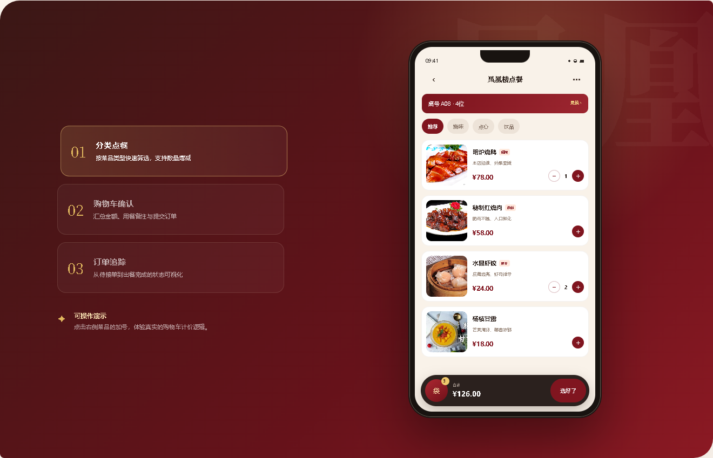
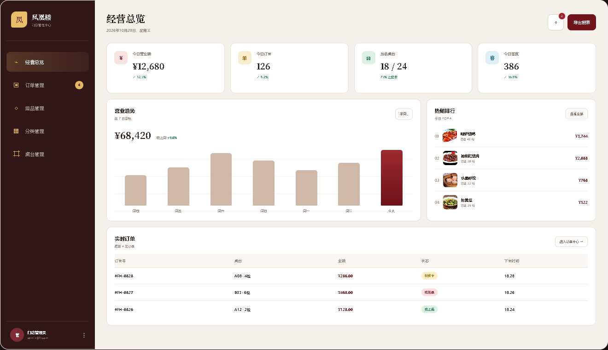

<div align="center">

# 凤凰楼 · 餐厅点餐管理系统

微信小程序点餐端、Web 商家管理后台、Node.js API 与 MySQL 数据库组成的完整堂食解决方案。

[在线体验](https://wxl31689.github.io/portfolio/) · [功能说明](#核心功能) · [本地运行](#本地运行) · [项目评估](./PROJECT_AUDIT.md)

</div>


## 在线可视化体验

访问 **[wxl31689.github.io/portfolio](https://wxl31689.github.io/portfolio/)**，无需安装微信开发者工具或连接数据库，即可浏览项目的完整界面与核心交互：

- 切换推荐、烧味、点心和饮品分类；
- 添加或减少菜品，实时计算购物车数量与金额；
- 查看购物车、提交订单并追踪制作状态；
- 切换经营总览、订单管理和菜品管理后台视图；
- 在桌面与移动设备上自适应展示。

> 在线体验页使用静态演示数据，不会创建真实订单；项目源码中的小程序与后台管理页面连接 Express + MySQL 接口。

## 界面预览

### 顾客点餐端



### 商家经营后台



## 核心功能

| 使用端 | 已实现功能 |
| --- | --- |
| 微信小程序 | 桌号与人数选择、首页推荐、分类点餐、购物车、用餐备注、下单、模拟支付、订单详情、订单状态轮询、我的订单 |
| 商家后台 | 管理员登录、经营数据概览、近 7 日销售趋势、热销排行、订单提醒与状态流转、订单详情与打印、菜品图片上传、分类管理、桌台管理 |
| 服务端 | 菜品、分类、订单、支付、上传、后台管理和经营统计 REST API，订单事务处理，图片地址归一化 |
| 数据库 | 管理员、分类、菜品、订单、订单明细、桌台等 MySQL 表结构与演示数据 |

## 本轮界面完善

- 新增 GitHub Pages 项目展示站，集中展示顾客端、商家端、业务流程和技术架构；
- 新增可操作的静态点餐演示，不依赖后端也能体验购物车和订单状态；
- 重做小程序“我的订单”页面，增加桌台信息、状态标签、金额和空状态；
- 重做小程序“订单详情”页面，增加订单进度、状态说明、菜品明细和固定操作栏；
- 更新仓库首页说明与界面截图，使访问者可以直接理解项目功能；
- 移除展示页的第三方字体运行依赖，提升 GitHub Pages 在不同网络环境下的稳定性。

更完整的现状分析、风险与后续优先级见 [PROJECT_AUDIT.md](./PROJECT_AUDIT.md)。

## 技术栈

- **顾客端：** 微信小程序原生 WXML / WXSS / JavaScript
- **管理端：** HTML / CSS / JavaScript
- **展示站：** 响应式 HTML / CSS / JavaScript，无构建依赖
- **服务端：** Node.js / Express
- **数据库：** MySQL / mysql2
- **文件上传：** Multer

## 项目结构

```text
portfolio/
├── index.html                  # GitHub Pages 可视化体验入口
├── assets/                     # 展示站样式、交互脚本与页面截图
├── admin-web/                  # 商家 Web 管理后台
│   ├── dashboard.html          # 经营统计
│   ├── orders.html             # 订单处理
│   ├── dishes.html             # 菜品管理
│   ├── categories.html         # 分类管理
│   └── tables.html             # 桌台管理
├── miniprogram/                # 微信小程序点餐端
├── server/                     # Express API 与上传资源
│   ├── routes/                 # 接口路由
│   ├── uploads/                # 菜品图片
│   ├── app.js                  # 服务入口
│   └── db.js                   # MySQL 连接
├── restaurant_order.sql        # 数据库结构与演示数据
└── PROJECT_AUDIT.md            # 项目审查与改进建议
```

## 本地运行

### 1. 初始化数据库

创建 MySQL 数据库并导入 [`restaurant_order.sql`](./restaurant_order.sql)，然后根据本地环境配置 `server/db.js`。

### 2. 启动接口服务

```bash
cd server
npm install
npm run dev
```

接口默认运行在 `http://localhost:3000`。

### 3. 运行顾客端与商家端

- 使用微信开发者工具导入 `miniprogram` 目录；
- 浏览器打开 `admin-web/login.html` 进入商家后台；
- 浏览器直接打开仓库根目录 `index.html` 可查看静态项目展示站。

## 演示账号

```text
账号：admin
密码：123456
```

演示账号只适用于本地开发。正式部署前必须改为环境变量配置、加密密码和服务端鉴权。

## 页面部署

仓库根目录的 `index.html` 可直接由 GitHub Pages 部署，无需打包。Pages 设置为从 `main` 分支根目录发布后，访问：

```text
https://wxl31689.github.io/portfolio/
```

## 项目定位

该项目覆盖了餐厅堂食的核心业务闭环，适合作为全栈课程设计、毕业设计原型或餐饮数字化系统的二次开发基础。当前版本已经具备完整演示能力；若用于生产环境，请优先完成服务端鉴权、真实支付、环境配置、自动化测试和部署监控。
