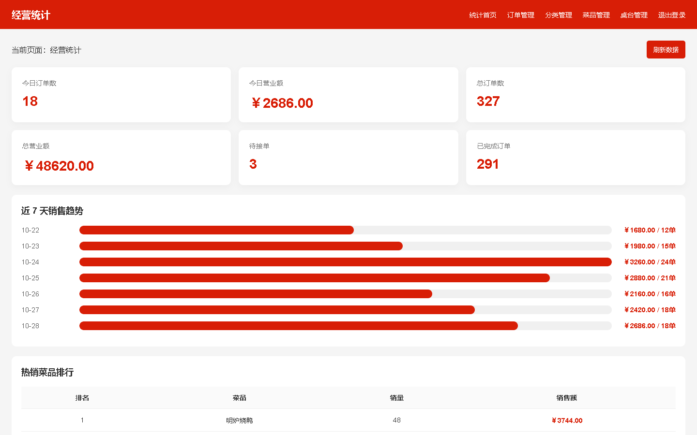
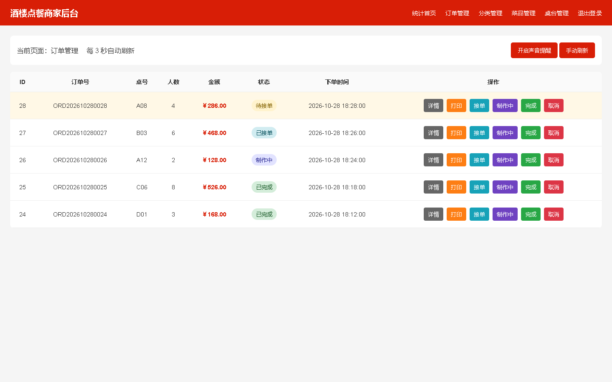
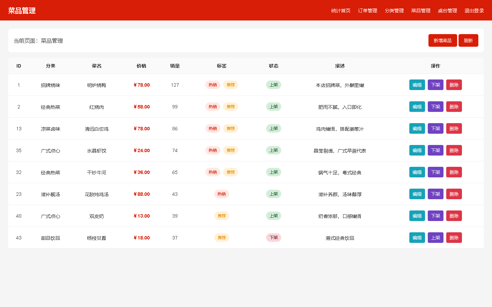
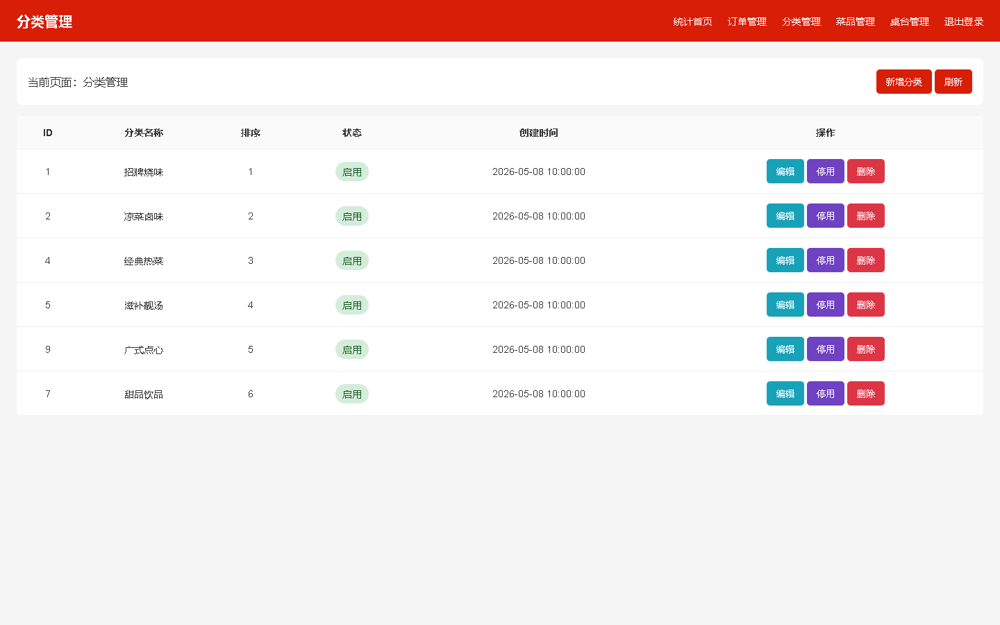
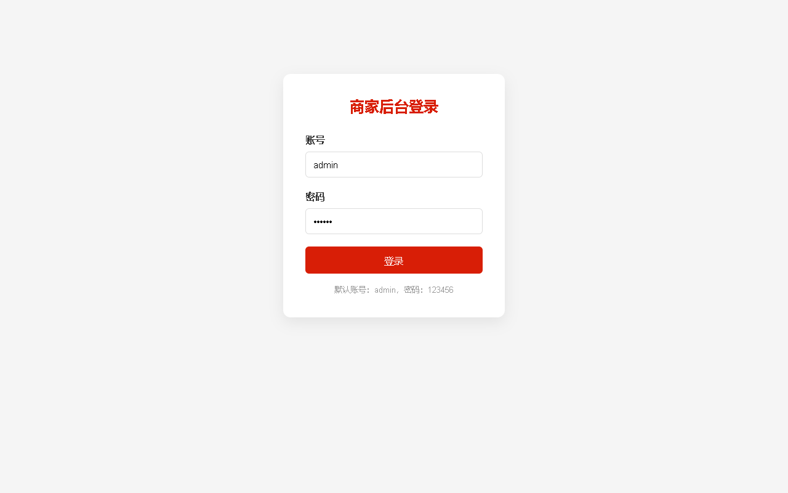

<div align="center">

# 餐厅点餐管理系统

微信小程序点餐端、Web 商家管理后台、Node.js API 与 MySQL 数据库组成的堂食点餐系统。

[真实页面展示](https://wxl31689.github.io/portfolio/) · [功能说明](#项目功能) · [本地运行](#本地运行) · [项目评估](./PROJECT_AUDIT.md)

</div>

> 下方图片全部由本仓库 `admin-web` 中的真实 HTML、CSS、JavaScript 页面运行后截取，不是 AI 生成图片，也不是重新绘制的概念稿。

## 真实前端页面

### 经营统计



### 订单管理



### 菜品管理



### 分类管理



### 商家登录



更多说明可访问 **[GitHub Pages 真实页面画廊](https://wxl31689.github.io/portfolio/)**。

## 项目功能

| 使用端 | 已实现功能 |
| --- | --- |
| 微信小程序 | 桌号与人数选择、首页推荐、分类点餐、购物车、用餐备注、下单、模拟支付、订单详情、订单状态轮询、我的订单 |
| 商家后台 | 管理员登录、经营数据概览、近 7 日销售趋势、热销排行、订单提醒与状态流转、订单详情与打印、菜品图片上传、分类管理、桌台管理 |
| 服务端 | 菜品、分类、订单、支付、上传、后台管理和经营统计 REST API，订单事务处理，图片地址归一化 |
| 数据库 | 管理员、分类、菜品、订单、订单明细、桌台等 MySQL 表结构与演示数据 |

## 微信小程序页面

小程序源码位于 [`miniprogram/pages`](./miniprogram/pages)，包含：

- `pages/index`：桌号、人数选择与首页推荐；
- `pages/menu`：分类点餐、菜品加减与购物车入口；
- `pages/cart`：购物车、备注、提交订单与支付；
- `pages/orderDetail`：订单状态、进度与菜品明细；
- `pages/myorders`：当前桌台订单列表；
- `pages/profile`：用餐信息与功能入口。

GitHub Pages 无法直接运行微信小程序容器，因此仓库没有用模拟图代替小程序运行截图。请使用微信开发者工具导入 `miniprogram` 目录查看真实运行页面。

## 本轮完善

- 使用项目真实 Web 页面生成并上传登录、经营统计、订单、菜品和分类管理截图；
- 新增 GitHub Pages 真实页面画廊，所有图片均可点击查看原始尺寸；
- 重做小程序“我的订单”页面，增加桌台信息、状态标签、金额和空状态；
- 重做小程序“订单详情”页面，增加订单进度、状态说明、菜品明细和固定操作栏；
- 增加 [PROJECT_AUDIT.md](./PROJECT_AUDIT.md)，记录现有不足与推荐迭代顺序。

## 技术栈

- **顾客端：** 微信小程序原生 WXML / WXSS / JavaScript
- **管理端：** HTML / CSS / JavaScript
- **服务端：** Node.js / Express
- **数据库：** MySQL / mysql2
- **文件上传：** Multer

## 项目结构

```text
portfolio/
├── index.html                  # GitHub Pages 真实截图画廊
├── assets/real-pages/          # 项目页面实际运行截图
├── admin-web/                  # 商家 Web 管理后台
├── miniprogram/                # 微信小程序点餐端
├── server/                     # Express API 与上传资源
├── restaurant_order.sql        # 数据库结构与演示数据
└── PROJECT_AUDIT.md            # 项目审查与改进建议
```

## 本地运行

### 1. 初始化数据库

创建 MySQL 数据库并导入 [`restaurant_order.sql`](./restaurant_order.sql)，然后根据本地环境修改 `server/db.js`。

### 2. 启动接口服务

```bash
cd server
npm install
npm run dev
```

接口默认运行在 `http://localhost:3000`。

### 3. 运行前端

- 使用微信开发者工具导入 `miniprogram` 目录；
- 浏览器打开 `admin-web/login.html` 进入商家后台；
- 浏览器打开仓库根目录 `index.html` 查看真实页面截图画廊。

## 演示账号

```text
账号：admin
密码：123456
```

演示账号只适用于本地开发。正式部署前应改用环境变量、密码哈希和服务端鉴权。

## 页面部署

仓库根目录可直接由 GitHub Pages 从 `main` 分支发布：

```text
https://wxl31689.github.io/portfolio/
```

## 项目定位

项目覆盖餐厅堂食的主要业务流程，适合作为全栈课程设计、毕业设计原型或餐饮系统的二次开发基础。若用于生产环境，应优先完善服务端鉴权、真实支付、环境配置、自动化测试和部署监控。
